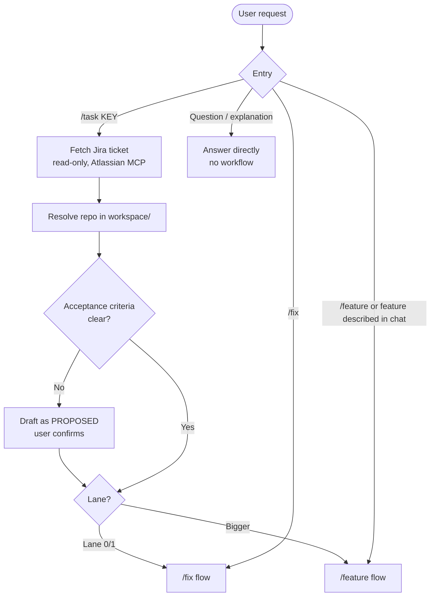
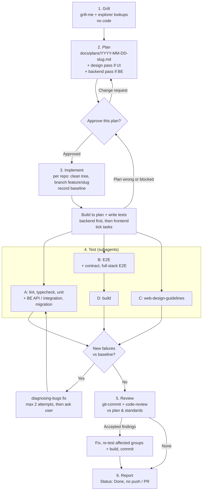
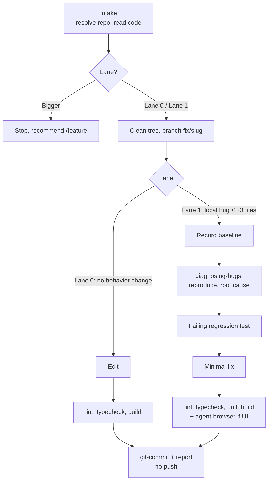

# Simple Delivery Template

A Claude Code template that turns a feature description into shipped, tested code:

**Grill → Plan → Approve → Implement → Test → Review → Report**

The full workflow is defined in [CLAUDE.md](CLAUDE.md).

## Setup

Requirements: Node.js 20+, Python 3.9+, git, Claude Code.

1. **Browser CLI** (used by `agent-browser` and `next-dev-loop`)

   ```bash
   npm i -g agent-browser && agent-browser install
   ```

2. **Playwright for Python** (used by `webapp-testing`)

   ```bash
   python3 -m pip install --user playwright && python3 -m playwright install chromium
   ```

3. **Figma MCP** (optional, only for features with a Figma design) — connect the Figma connector in Claude Code.

   **Atlassian MCP** (optional, only for `/task`) — connect the Atlassian (Jira) connector in Claude Code and authorize it.

4. **Skills** — all skills live locally in `.claude/skills/` and are edited in place; there is no install or update step. `web-design-guidelines` reads its rules from a local `guidelines.md` (no network fetch). `agent-browser` is a stub that loads its usage guide from the installed CLI (`agent-browser skills get core`).

   Do not keep skills with the same names in your global `~/.claude/skills/`: a global skill with the same name overrides the project copy, so local edits would be ignored.

## Usage

1. Clone the target repo(s) into `workspace/` (skip for a new app — it will be scaffolded there). Frontend and backend are separate repos, e.g. `workspace/my-web` and `workspace/my-api`.
2. Open this folder in Claude Code and run:

   ```
   /feature <describe the feature or app>
   ```

   Or just describe the feature in chat.
3. Answer the grilling questions (`grill-me`), review the plan in `docs/plans/`, and approve it. Nothing is built until you approve.
4. Claude implements on a `feature/<slug>` branch, tests, commits, reviews against the plan, and reports. It does not push or open a PR unless you ask.

If a plan is left `Approved` or `In progress`, the next session offers to resume it from the first unticked task.

### Frontend + backend features

When a feature needs both repos, one plan covers both. The plan's **Backend** section fixes the API contract (endpoints, request / response, errors), schema changes and migrations, and new config — this is approved together with the rest of the plan. Claude builds the backend first, then the frontend against that contract, using the same `feature/<slug>` branch name in each repo. Baseline, tests, commits, and review run per repo; Phase 4 adds backend API / integration tests (local / test DB only), a migration up / down check, a FE ↔ BE contract check, and full-stack E2E. Backend rules are stack-agnostic and live in [docs/standards.md](docs/standards.md) → **Backend**.

### Small fixes

For a typo, copy/config change, or a small local bug (≤ ~3 files, no new requirement), skip the plan:

```
/fix <describe the fix or bug>
```

Claude confirms the lane (recommends `/feature` if it is bigger), branches `fix/<slug>`, records a test baseline, reproduces the bug with a failing regression test, fixes it, verifies, commits, and reports. No push.

### Jira tickets

```
/task <JIRA-KEY>
```

Claude reads the ticket via the Atlassian MCP (read-only), resolves the repo, proposes acceptance criteria if they are missing, classifies the lane, and routes it to `/fix` or the `/feature` workflow (grilling only on what the ticket leaves open). The key goes into the branch, plan file name, and commit messages.

### Guardrails

Both commands follow the **Guardrails** in [CLAUDE.md](CLAUDE.md): pre-existing test failures are recorded as a baseline (only new failures count), Claude stops and asks after 2 failed fix attempts, tests are never skipped or weakened, missing acceptance criteria are proposed as `[PROPOSED]` for you to confirm, and checks that can't be automated become `[manual]` steps.

## Workflow diagrams

### Entry points



### `/feature`



### `/fix`



## Rule precedence

[CLAUDE.md](CLAUDE.md) and [docs/standards.md](docs/standards.md) override your global `~/.claude/CLAUDE.md` where they overlap — including the approval rule (an approved plan covers every file it lists). A target repo's own documented standards (e.g. `CONTRIBUTING.md`) take precedence over `docs/standards.md`.

## Skills by phase

| Phase | Skills |
|---|---|
| Grill | `grill-me` |
| Plan (design pass) | `frontend-design` (no UI source), Figma MCP (Figma), `frontend-design-system` (existing components) |
| Plan (backend pass) | No skill — rules in `CLAUDE.md` and `docs/standards.md` → **Backend** |
| Implement | Frontend: `frontend-react-typescript`, `frontend-api-integration`, `frontend-accessibility`, `vercel-react-best-practices`, `vercel-composition-patterns`, `next-best-practices`. Backend: the repo's own conventions + `docs/standards.md` → **Backend** |
| Test | `vitest`, `frontend-testing`, `agent-browser`, `webapp-testing`, `next-dev-loop`, `web-design-guidelines`; backend repo's own test runner and migration tool; `diagnosing-bugs` on failure |
| Review | `git-commit`, `code-review` (Standards: `docs/standards.md` + repo docs; Spec: the plan) |

## Subagents

Defined in `.claude/agents/` to keep long output out of the main context:

- `explorer` (Haiku, read-only) — looks up repo facts during Grill and Plan.
- `test-runner` (Sonnet, reports only) — runs lint, typecheck, unit, backend API / integration, migration, contract, E2E, and build in Phase 4 and returns a compact pass/fail report. Works with any stack (reads commands from the repo's build files and docs) and uses only a local / test database. Groups run in parallel; build runs last.

## Layout

```
.claude/
  agents/               # subagents (explorer, test-runner)
  commands/feature.md   # /feature entry point
  commands/fix.md       # /fix entry point (Lane 0/1 small fixes)
  commands/task.md      # /task entry point (Jira ticket intake)
  skills/               # project skills (local, edited in place)
  templates/plan.md     # plan template
docs/plans/             # one plan per feature (git-ignored, local only)
docs/standards.md       # coding standards for workspace repos
workspace/              # code repos (git-ignored, each keeps its own history)
```
